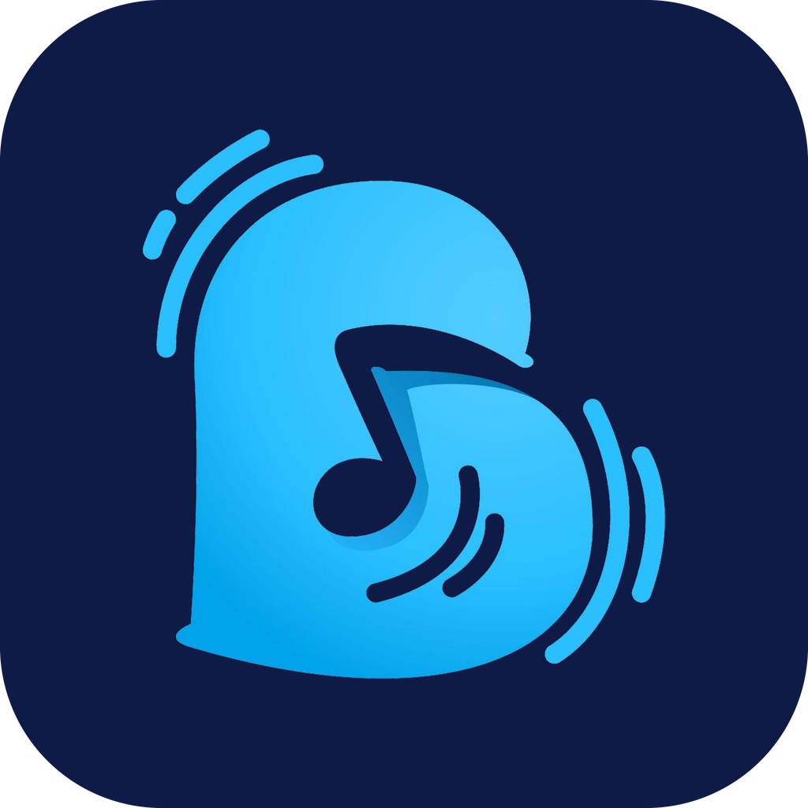
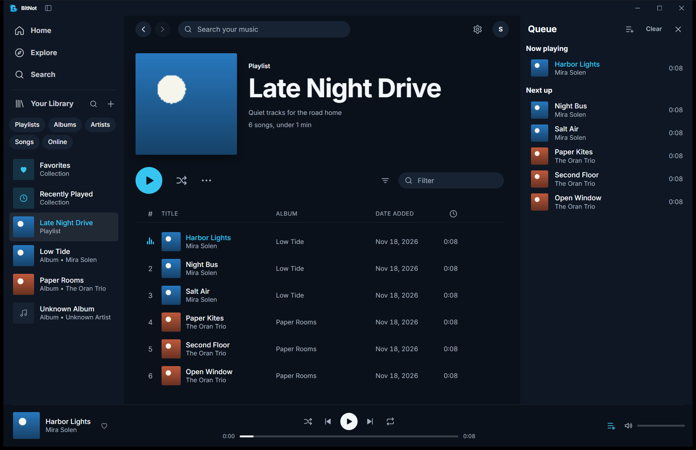

<p align="center">
  
</p>

<h1 align="center">BitNot</h1>

<p align="center"><strong>Your Music. Your Way.</strong></p>

BitNot is a local-first music player for Windows. Your own music files are the core of the app: it scans the folders you choose, plays your music offline, and keeps your playlists, favorites, and listening history on your own computer. No account, server, or subscription is required, and BitNot never uploads your music or library.



> **Status: early development — Phase 2 of 7 complete.**
> The local library and core playback work. Online music, lyrics, the equalizer, a Now Playing screen, Windows media controls, device sync, and an installer are **not built yet**. There is no release; build from source to try it.

## Features

What exists today (Phases 1 and 2):

**Library**
- Scans the music folders you choose, optionally including subfolders, and watches them for changes while the app is running.
- Reads tags, duration, codec, bitrate, sample rate, bit depth, and embedded or folder cover art.
- Recognises moved or renamed files, keeping their favorites, play counts, and playlist entries.
- Songs, Albums, Artists, Playlists, and Recently Added views, in a grid or a list, with sorting by title, artist, album, duration, or date added.
- Artist pages with Popular Tracks (from your own play counts) and albums newest first.
- Identical recordings in several formats are shown once, with a choice of which version to play.
- Edit title, artist, album, genre, year, and track number. Edits are kept in BitNot; your audio files are never modified.

**Playback**
- Play, pause, seek, next, previous, shuffle, repeat, and volume.
- A queue with Play Next, Add to Queue, drag-and-drop reordering, and Save Queue as Playlist. The queue and position are restored after a restart.
- Favorites, play counts, and listening history.

**Playlists and safety**
- Playlists with descriptions, custom covers, and drag-and-drop ordering.
- A Recycle Bin keeps deleted playlists, removed tracks and favorites, and earlier versions of edited details for 90 days.
- Remove from Library takes a track out of BitNot only. **BitNot never moves, changes, or deletes your music files.**
- Damaged databases are rebuilt automatically where safe; the damaged original is always kept.

**Search**
- Instant local search across titles, artists, and albums, ignoring case and accents. Exact matching only: no typo guessing.

**Interface**
- Dark and light themes, accent colours, display scaling, and Reduce Motion.
- Keyboard control of track lists and menus; screen-reader labels.
- Multiple profiles, each with its own library, playlists, and settings.

## Supported audio formats

| Format | Status |
|---|---|
| MP3, FLAC, WAV, AIFF, AAC (M4A), ALAC (M4A) | Played and measured on a real output device |
| Ogg Vorbis | Accepted, but not yet tested with a real file |
| Opus, WMA, APE, DSD, WavPack | Not supported; listed as skipped |

## Roadmap

| Phase | Scope | Status |
|---|---|---|
| 1 | Foundation: shell, theming, database, settings, profiles, setup, diagnostics | Done |
| 2 | Local library and core playback | Done, with the limits below |
| 3 | Now Playing, Mini Player, equalizer and effects, gapless, crossfade, lyrics, visualizer, shortcuts | Not started |
| 4 | Online catalogs from providers whose terms permit it | Not started |
| 5 | Windows integration: media controls, lock screen, tray, output devices, notifications | Not started |
| 6 | Local-network sync between trusted devices | Not started |
| 7 | Stability, backup, installer, releases | Not started |

The full product specification is in [CLAUDE.md](CLAUDE.md). What was built and verified, phase by phase, is in [docs/implementation-log.md](docs/implementation-log.md) and [docs/reports/](docs/reports/).

## Known limitations

- Developed and tested on Windows 11 only. Windows 10 is untested.
- No installer or signed build yet.
- The output device is chosen when the app starts; switching devices needs a restart.
- Search does not transliterate Japanese, Korean, or Chinese.
- English is the only language; part of the interface text is not yet in the translation system.
- Only tested with small libraries; performance with tens of thousands of tracks is not measured.

## Architecture

| Layer | Technology |
|---|---|
| Desktop shell | [Tauri 2](https://tauri.app) with the Microsoft Edge WebView2 runtime |
| Core | Rust: library, scanner, playback, queue, settings, profiles, diagnostics |
| Audio | [rodio](https://github.com/RustAudio/rodio) with [Symphonia](https://github.com/pdeljanov/Symphonia) decoders, WASAPI output |
| Tags | [lofty](https://github.com/Serial-ATA/lofty-rs), read-only |
| Storage | SQLite (bundled `rusqlite`), forward-only migrations |
| Interface | React 19, TypeScript, Vite |

The interface calls a thin command layer (`src-tauri/src/lib.rs`), which wraps an application core (`src-tauri/src/core.rs`) that has no dependency on the UI and is tested directly.

| Path | Contents |
|---|---|
| `src/` | Interface. `styles/tokens.css` holds the design tokens; `i18n/` the translations. |
| `src-tauri/src/core.rs` | Application core: every operation the interface can request. |
| `src-tauri/src/db.rs` | SQLite access, migrations, and safe repair. |
| `src-tauri/src/scanner.rs`, `watcher.rs` | Folder scanning and folder watching. |
| `src-tauri/src/library.rs` | Library queries, playlists, favorites, history, metadata edits, Recycle Bin, search. |
| `src-tauri/src/playback.rs`, `queue.rs` | Audio output, playback controller, and queue logic. |
| `src-tauri/src/artwork.rs`, `textfold.rs` | Artwork cache and thumbnails; text folding for search. |
| `src-tauri/src/profiles.rs`, `settings.rs`, `diagnostics.rs` | Profiles, settings, and local logs. |
| `docs/` | Implementation log, reports, design and brand assets. |

## Your data

BitNot stores its databases, settings, cover-art cache, and logs in `%APPDATA%\app.bitnot.desktop`. It only reads your music folders. Logs stay on your computer and are never sent anywhere.

## Building from source

Requirements:

- Windows 10 or 11
- [Node.js](https://nodejs.org) 24 or newer
- [Rust](https://rustup.rs) stable with the MSVC toolchain
- Visual Studio 2022 Build Tools with "Desktop development with C++"
- Microsoft Edge WebView2 Runtime (preinstalled on Windows 11)

Install dependencies:

```bash
npm install
```

Run the app in development mode:

```bash
npm run tauri dev
```

## Checks

```bash
npm run typecheck
```

```bash
npm test
```

```bash
cd src-tauri && cargo fmt --check && cargo clippy --all-targets -- -D warnings && cargo test
```

The same checks run in GitHub Actions on every push and pull request.

## Brand assets

The BitNot logo is a capital B integrated with a musical note, with sound-wave accents, in cyan on deep navy.

| File | Use |
|---|---|
| `docs/design/references/bitnot-logo-approved.jpg` | Approved original |
| `docs/design/brand/bitnot-mark.png` | Transparent mark |
| `docs/design/brand/bitnot-app-icon.png` | App icon (mark on navy tile) |
| `docs/design/brand/bitnot-mark-on-dark.png`, `bitnot-mark-on-light.png` | Mark on dark and light backgrounds |
| `src-tauri/icons/` | Windows icons generated from the app icon |

## License

BitNot is licensed under the [Apache License 2.0](LICENSE).
